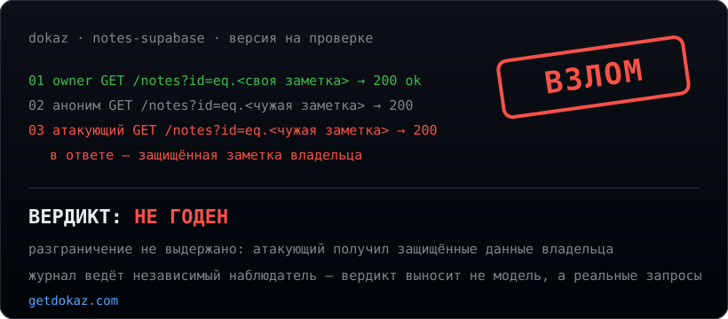

# Dokaz

### Не мнение. Доказательство.

Dokaz поднимает твоё веб-приложение, заводит двух пользователей и **по-настоящему пытается прочитать чужие данные.**
Вердикт выносит не модель, а журнал реальных запросов.

первый аудит бесплатно · mac и windows · код проекта не покидает твою машину

🇷🇺 Русский · [🇬🇧 English](#-english)

---

## Ты навайбкодил. А оно держит чужих?

Ты собрал приложение — быстро, с ИИ, работает. Вопрос один: **может ли один пользователь прочитать данные другого?** На это не ответит ни линтер, ни модель «на глаз». На это отвечает только настоящая попытка.

Dokaz делает эту попытку у тебя на машине:

1. Берёт папку с твоим проектом.
2. Поднимает его копию в изолированном контейнере.
3. Заводит двух пользователей и **атакует** — ходит за данными владельца от лица чужого.
4. Выдаёт вердикт: **ГОДЕН** или **НЕ ГОДЕН**, с журналом каждого запроса и списком «что чинить».

## Чем это отличается от «спроси у ИИ»

- **Настоящий вердикт, а не мнение.** Решение выносится по журналу реальных запросов, а не по тому, что «подумала» модель.
- **Настоящий взлом.** Dokaz не рассуждает об уязвимости — он её воспроизводит на запущенной копии: вот запрос, вот `200`, вот чужие данные в ответе.
- **Проверяемо.** Журнал ведёт независимый наблюдатель-прокси: одна запись на каждый реальный запрос, в том порядке, в котором они были. Это можно перечитать и перепроверить.
- **Твой код никуда не уходит.** Сборка, запуск и атака идут на твоём компьютере. Ни строки кода, ни одного ответа приложения мы не видим.
- **Любая модель — по твоему ключу.** Ставишь ключ своего провайдера, выбираешь любую модель. Dokaz ничего не навязывает.

## Что ты получаешь после прогона

- **Вердикт** по разграничению доступа: держит или не держит.
- **Журнал атаки** — какой запрос пробил защиту и что утекло.
- **Что чинить** — конкретное действие по каждой находке, на языке твоего стека.

## С чем работает

Supabase (RLS), Firebase, Hasura, PocketBase — и обычные бэкенды: Express, FastAPI, Django, Flask, Rails, Spring, NestJS, Next.js, Laravel, GraphQL и другие. Ты просто указываешь папку проекта.

## Поставить и попробовать

Первый аудит на каждом аккаунте — **бесплатно**. Подписка нужна только дальше.

- **Windows** → [getdokaz.com/windows](https://getdokaz.com/windows/) — скачал, поставил, выбрал проект, ввёл ключ модели.
- **macOS** → [getdokaz.com/mac](https://getdokaz.com/mac/) — подписано нами и проверено Apple, открывается без предупреждений.

> Это витрина продукта. Движок Dokaz закрыт — чтобы его нельзя было обойти, зная внутреннюю кухню. Здесь — только то, что он делает и что получаешь ты.

## Коротко

- **Код уходит к вам?** Нет. Всё на твоей машине.
- **Что нужно поставить руками?** Ничего, кроме приложения. Остальное оно ставит само при первом запуске.
- **Нужен свой ключ модели?** Да — так ты платишь провайдеру напрямую и выбираешь любую модель.
- **Сколько стоит попробовать?** Первый аудит — ноль.

---

# Dokaz

### Not an opinion. Proof.

Dokaz spins up your web app, creates two users and **actually tries to read one user's data as the other.**
The verdict comes from a log of real requests, not from a model's guess.

first audit free · mac and windows · your project's code never leaves your machine

**You vibe-coded it. Does it hold against other users?**

You shipped an app — fast, with AI, it works. One question remains: **can one user read another user's data?** A linter won't tell you. A model eyeballing your code won't tell you. Only a real attempt will.

Dokaz makes that attempt on your machine:

1. Takes your project folder.
2. Runs a copy in an isolated container.
3. Creates two users and **attacks** — reaches for the owner's data as someone else.
4. Returns a verdict: **PASS** or **FAIL**, with every request logged and a "what to fix" list.

**Why it's different**

- **A real verdict, not an opinion** — decided by a log of real requests, not by what a model "thinks".
- **A real breach** — Dokaz reproduces the flaw on a running copy: here's the request, here's the `200`, here's the other user's data in the response.
- **Verifiable** — an independent proxy observer logs one record per real request, in order. You can re-read and re-check it.
- **Your code stays put** — build, run and attack all happen on your computer. We never see a line of your code or a single response.
- **Any model, your key** — set your provider's key, pick any model. Nothing is forced on you.

**What you get:** a PASS/FAIL verdict on access control, the attack log showing what leaked, and a concrete fix per finding in your stack's terms.

**Works with** Supabase (RLS), Firebase, Hasura, PocketBase and plain backends: Express, FastAPI, Django, Flask, Rails, Spring, NestJS, Next.js, Laravel, GraphQL and more.

**Try it** — the first audit on every account is free. → **[getdokaz.com](https://getdokaz.com/)**

> This is the product's showcase. The Dokaz engine is closed on purpose, so it can't be gamed by knowing its internals. What's here is what it does and what you get.

---

<a href="https://getdokaz.com/">getdokaz.com</a> · <a href="https://getdokaz.com/privacy/">Приватность</a> · <a href="https://getdokaz.com/terms/">Условия</a> · support@getdokaz.com

